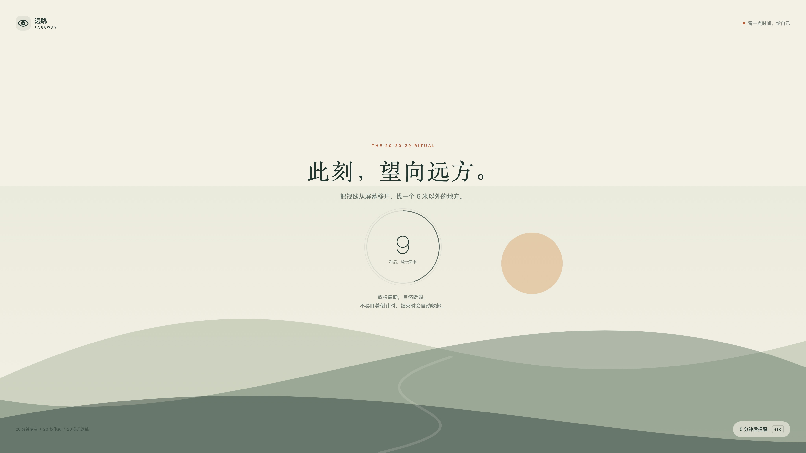
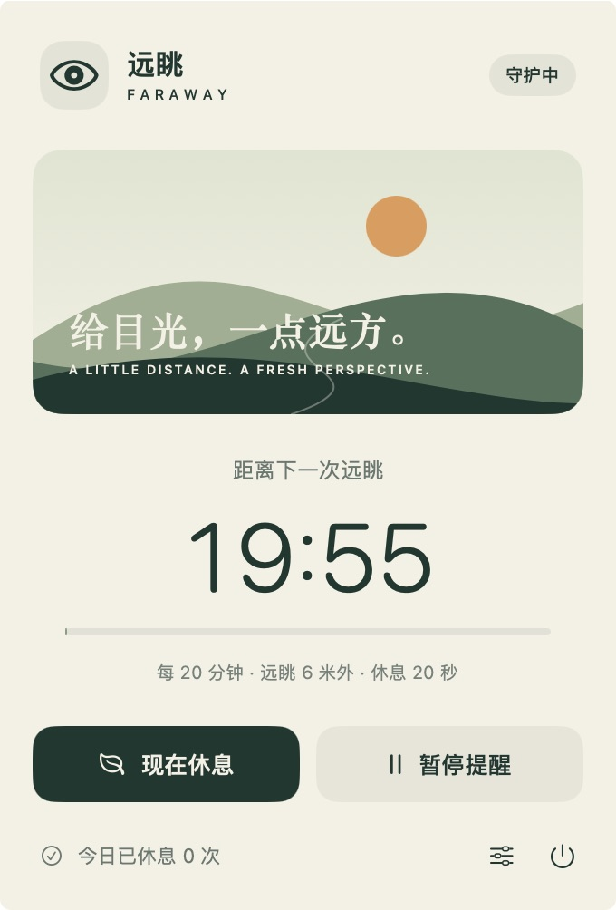

# 远眺 · Faraway

一个原生 macOS 菜单栏休息提醒工具。每隔 20 分钟，用全屏界面提醒你看向约 6 米外的物体，休息 20 秒。

暖白底色、松绿色山景和轻缓的呼吸动画，让眼睛从屏幕上移开一会儿。



## 功能

- **菜单栏常驻**：显示距离下一次休息的倒计时，可随时暂停、继续或立即休息。
- **全屏提醒**：在各显示器上展示休息页，倒计时结束自动收起，并返回之前使用的应用。
- **延后提醒**：按 `Esc` 或点击「5 分钟后提醒」，中断的休息不会计入完成次数。
- **自定节奏**：间隔可选 20、30、45、60 分钟，休息时长可选 20、30、60 秒。
- **睡眠暂停**：根据系统睡眠、显示器休眠和用户会话状态通知暂停计时，所有暂停原因解除后恢复。
- **本地统计**：显示今日完成的休息次数，设置和统计保存在本机。
- **可选设置**：结束提示音、登录 Mac 时启动。
- **减少动态效果**：跟随系统辅助功能设置，关闭呼吸动画和倒计时圆环过渡。

应用没有第三方依赖，不需要注册账号，也不采集或上传使用数据。

<details>
<summary>查看控制面板</summary>



</details>

## 下载与安装

在 [GitHub Releases](https://github.com/shaw-baobao/Faraway/releases/latest) 下载最新版本：

- `Faraway-1.0.0-macos-arm64.dmg`：打开磁盘映像，将「远眺」拖入「Applications」。
- `Faraway-1.0.0-macos-arm64.zip`：解压后，将`远眺.app`移入「应用程序」文件夹。

安装后可在「应用程序」中打开「远眺」，也可用 Spotlight 搜索「远眺」。应用主要运行在菜单栏，首次启动会显示控制面板，后续可点击眼睛图标操作。

当前预编译包适用于 Apple Silicon Mac，最低 macOS 14。应用采用本机临时签名，尚未经过 Apple 公证，在其他 Mac 上可能被 Gatekeeper 拦截；如果无法打开，可按下方步骤从源码本机构建。Intel Mac 暂不提供预编译包。

## 构建与运行

需要 macOS 14 或更新版本，以及 Swift 6 工具链。开发时使用 Xcode 27.1 和 Swift 6.4，其他兼容工具链尚待验证。

```sh
git clone https://github.com/shaw-baobao/Faraway.git
cd Faraway
./scripts/build.sh
open dist/Faraway.app
```

脚本会构建当前 Mac 架构的可执行文件，生成 `dist/Faraway.app` 并进行本机临时签名。也可以用 Xcode 打开 `Package.swift` 查看和编辑源码。

首次启动会显示控制面板。关闭窗口后，点击菜单栏里的眼睛图标和倒计时即可继续操作。再次打开应用也能召回控制窗口。

长期使用时，可将 `Faraway.app` 移到「应用程序」文件夹，再在偏好设置中打开「登录 Mac 时启动」。系统可能要求在「系统设置 → 通用 → 登录项」中允许。

源码历史不包含编译产物，预编译包通过 GitHub Releases 单独提供。Intel Mac 需要在对应架构环境构建。

## 测试

仓库配置了 GitHub Actions，在 macOS runner 上执行单元测试、应用构建和应用包校验。运行结果以仓库的 Actions 页面为准。

```sh
swift test
```

计时测试覆盖正常周期、暂停续计、延后、睡眠中断及延迟触发；暂停条件测试覆盖系统、屏幕、用户会话重叠，以及重复或不匹配的通知。

应用尚未运行时，可立即预览一次全屏休息，预览不增加今日休息统计：

```sh
open dist/Faraway.app --args --preview
```

本机已检查界面渲染和倒计时自动收起。多显示器、系统登录项、真实睡眠及用户会话切换仍需实机验证。当前实现依赖系统通知，未单独检测屏幕锁定状态。

## 代码结构

```text
Sources/
  Faraway/       菜单栏、设置、全屏窗口与界面
  RestCore/      计时状态机与暂停条件协调
Tests/
  RestCoreTests/ 计时和暂停条件测试
Assets/          应用图标
scripts/         本机构建脚本
```

## 关于 20-20-20

每隔 20 分钟，把视线从屏幕移开，看向至少 20 英尺（约 6 米）外的物体，持续至少 20 秒。参考[美国眼科学会的说明](https://www.aao.org/eye-health/tips-prevention/should-you-be-worried-about-blue-light)。

远眺用于提醒休息，不提供诊断或治疗功能。

## 参与贡献

欢迎通过 Issue 反馈问题或提交 Pull Request。反馈时请附上 macOS 版本、芯片架构、复现步骤和预期行为；涉及多屏或睡眠恢复时，请说明显示器配置及事件顺序。

## 许可证

[MIT](LICENSE)
